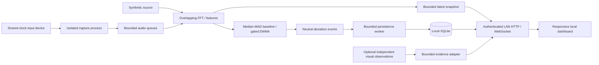

# Architecture

`audio.py` acquires float32 blocks from a local microphone or deterministic synthetic source. The PortAudio callback copies to a bounded eight-block queue and counts overruns. Native microphone calls run in a separate spawned process. A second bounded queue relays samples to the DSP worker; no DSP, disk or network work occurs inside the callback. Startup is cancellable and times out after six seconds. A hung driver process is terminated on stop, keeping the server responsive. Windows automatic input selection prefers the system WASAPI input; the inventory reports its actual native rate.

`dsp.py` applies a Hann window and FFT to a sliding frame, estimates peak frequencies, amplitude-normalized dBFS, spectral flux, amplitude-weighted centroid and relative noise floor. Log bins preserve local maxima. Sample rate and FFT size determine actual resolution; interpolated peak readouts do not add physical resolution.

Harmonic grouping is optional and heuristic. Frequency-shift estimates require a significant peak in the configured reference window. Competing similarly strong tones produce an ambiguous state. The continuous colour ramp has a green neutral plateau and continuous joins at its boundaries. Numerical measurements are not smoothed.

`baseline.py` uses a bounded 512-frame reservoir to estimate per-linear-FFT-bin median and scaled MAD. Optional clipped, time-based EWMA center adaptation excludes anomalous frames and supports freeze/reset. Named reviewed profiles persist atomically and are checked against input/spectral settings before reuse. Matching states are suggestions requiring operator activation. See [the model](acoustic-model.md) for thresholds, assumptions and limitations.

`events.py` detects positive and negative deviations on original FFT bins using both dB and robust variation thresholds. It tracks UUID event lifecycles, temporal descriptors and compact spectral evidence. `storage.py` applies an additive migration to existing JSON event storage, upserts active/completed observations, preserves annotations, and maintains compact reviewed signatures. SQLite uses WAL/locking with retention bounded to 5,000 events and 256 signatures. Scores are heuristics, not classification probabilities.

`api.py` adds authenticated versioned routes, filtered review/history and local OpenAPI documentation while preserving legacy paths. `integrations.py` keeps bounded ARGOS visual evidence and clock uncertainty separate from acoustic observations and rejects identity fields. `network.py` supplies optional mDNS and an explicitly enabled HTTPS fallback selector; direct public serving remains disabled. `stereo.py` exposes experimental time delay and unresolved two-microphone bearing ambiguity. None of these modules classifies physical sources.

The PyInstaller entry in `packaging/launcher.py` dispatches spawned native workers before importing the server. Static assets are bundled separately from writable external configuration/data. Packaging behavior and independent smoke-test boundaries are in [packaging](packaging.md).

Event writes use a separate persistence thread and a 128-entry queue. DSP submission
never waits for a slow event database. Queue saturation increments an exposed dropped
update counter and warning. Shutdown drains the queue before closing SQLite. Baseline
snapshots still save at low frequency; failures are visible warnings. UI event polling
is eventually consistent with queued writes, not a lossless delivery guarantee.

`engine.py` owns acquisition, the sliding window, latest frame and bounded shift/bearing histories. Analysis runs at the hop cadence. Dashboard snapshots publish at an independent update rate. Slow browsers receive the newest snapshot rather than a queue. WebSocket writes time out after two seconds.

Control operations are serialized separately from snapshot locking, so stopping a worker never holds the lock the worker needs to finish. Threshold/reference controls update in place; source/format changes restart acquisition. New streams have unique IDs. Sequence discontinuities, overruns and reconnects clear the rolling FFT window and temporal associations. Missing, stopped or stale data invalidate current direction/shift readouts. Calibration counts contiguous acquired intervals rather than time spent disconnected. Baseline write failures are warnings rather than fatal acquisition errors, and adapted profiles are saved periodically and on stop.

`server.py` exposes REST controls and WebSockets. Loopback is the default; LAN binding
requires a six-digit PIN. `security.py` generates PINs and applies an atomic failed-guess
budget across login, bearer requests and WebSocket handshakes; successful browser
logins receive independent random session credentials. Same-origin checks protect
browser controls and sockets. Dashboard scripts and charts are served locally with
no CDN or telemetry.

Archive clearing is an ordered command in the bounded persistence queue. Under the
engine's short snapshot lock, the command is enqueued and the active detector lifecycle
is reset. The HTTP worker waits for completion outside that lock. Pending old writes
finish before deletion; later detections are separate events and continue recording.
Only events/annotations are deleted. A small SQLite metadata row preserves monotonic
event IDs across clears/restarts so stale links cannot refer to new records.

`vision.py` adds an independently spawned local ARGOS camera/detector/tracker and
optional existing ArcFace catalogue. Bounded latest-frame queues isolate acquisition,
model inference, HTTP and browser playback. `vision_api.py` exposes authenticated
start/stop, frame/status and explicit catalogue controls. `vision.js` keeps a bounded
decoded-frame jitter buffer and paints synchronized frame/face metadata; it adds
direction-only visual rays to the existing polar instrument. Visual and acoustic
evidence are not causally associated. The older external `integrations.py` identity
restriction is preserved. See [geometry, cache limits and prerequisites](argos-integration.md).

`dashboard/` provides responsive canvas instruments, controls, event history and CSV export. Simulation, input errors, pause, unavailable direction and unreliable shift estimates have distinct visible states. The spectrogram and histories are bounded.

The responsive instrument layout is in `tactical.css`; `terminal.css` applies the
brutalist palette, flat surfaces and locally bundled IBM Plex fonts. Measurement
semantics and the continuous shift scale are preserved. See [theme details](terminal-theme.md).
A microphone-recovery panel exposes refresh, retry and replacement-input selection
during driver errors. Device changes invalidate previous array geometry unless
explicitly supplied again. Regular event polling retrieves five recent observations;
the archive loads in user-requested pages instead of rebuilding 5,000 rows every
two seconds. Browser requests time out, and socket loss invalidates displayed current
measurements.

Live direction is experimental GCC-PHAT plus far-field least squares for a measured synchronized planar array. Two distinct shared-clock channels support an ambiguous bearing pair through `direction.py` and `stereo.py`; three or more non-collinear channels use the planar least-squares path. Confidence/uncertainty are heuristic; narrowband signals and reflections can be ambiguous. A single microphone and independent unsynchronized devices do not supply the required spatial evidence.

The two-microphone display never picks one candidate arbitrarily. `possible_bearings_deg` contains both mirror directions, while `bearing_deg` is null. Pair spacing and channel-order orientation determine the delay-to-angle conversion. Direction and delay are invalidated when samples stop; device/channel changes revoke stereo synchronization verification. See [two-microphone setup](two-microphone-bearing.md).
